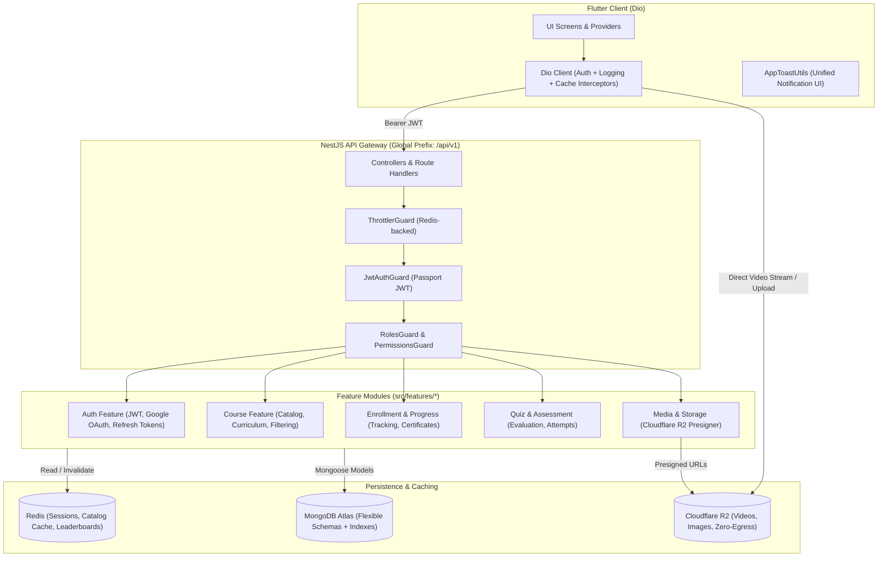
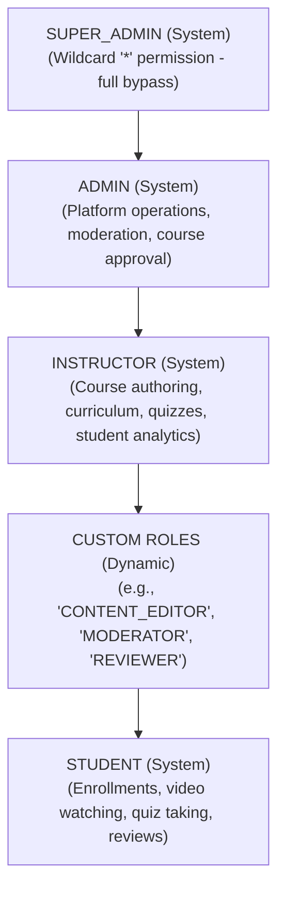

# Comprehensive Backend Architecture, Flexible Schema & RBAC Migration Plan

## 1. System Architecture Overview

This blueprint transitions the application from a Firebase-dependent mobile backend to an enterprise-grade **NestJS (TypeScript)** REST API powered by **MongoDB**, **Redis**, and **Cloudflare R2**, integrated with **Flutter via Dio**.



---

## 2. Dynamic Role & Permissions (Custom RBAC) Engine

Roles and Permissions are **fully dynamic** rather than hardcoded enums. Custom roles (e.g., `CONTENT_CREATOR`, `ASSISTANT`, `FINANCE_MANAGER`) can be created, updated, and assigned at runtime via the API or Admin Dashboard, with permission sets cached in Redis for sub-millisecond guard checks.

### 2.1 Dynamic Role Structure



### 2.2 Permissions Matrix

| Permission Key | Description | `STUDENT` | `INSTRUCTOR` | `ADMIN` | `SUPER_ADMIN` |
| :--- | :--- | :---: | :---: | :---: | :---: |
| `courses:read_published` | Browse public published courses | ✅ | ✅ | ✅ | ✅ |
| `courses:create` | Create new course drafts | ❌ | ✅ | ✅ | ✅ |
| `courses:update_own` | Edit owned courses/lessons | ❌ | ✅ | ✅ | ✅ |
| `courses:publish` | Approve and publish to catalog | ❌ | ❌ | ✅ | ✅ |
| `courses:delete_any` | Delete any course from platform | ❌ | ❌ | ❌ | ✅ |
| `lessons:upload_video`| Upload video lessons to Cloudflare R2 | ❌ | ✅ | ✅ | ✅ |
| `quizzes:attempt` | Take quiz and submit answers | ✅ | ✅ | ✅ | ✅ |
| `quizzes:manage_own` | Create/edit questions for course | ❌ | ✅ | ✅ | ✅ |
| `enrollments:create` | Enroll in free or paid course | ✅ | ✅ | ✅ | ✅ |
| `users:manage_roles` | Promote/demote user roles | ❌ | ❌ | ❌ | ✅ |
| `banners:manage` | Create promotional banners | ❌ | ❌ | ✅ | ✅ |

### 2.3 JWT Payload & Middleware Guards

```typescript
// src/shared/auth/jwt.types.ts
export type UserRole = 'SUPER_ADMIN' | 'ADMIN' | 'INSTRUCTOR' | 'ASSISTANT' | 'STUDENT';

export interface TokenPayload {
  userId: string;
  email: string;
  role: UserRole;
  permissions: string[];
  sessionId: string;
}
```

```typescript
// src/common/decorators/roles.decorator.ts
import { SetMetadata } from '@nestjs/common';
import { UserRole } from '../../features/users/enums/user-role.enum';

export const ROLES_KEY = 'roles';
export const Roles = (...roles: UserRole[]) => SetMetadata(ROLES_KEY, roles);
```

```typescript
// src/common/guards/roles.guard.ts
import { Injectable, CanActivate, ExecutionContext, ForbiddenException } from '@nestjs/common';
import { Reflector } from '@nestjs/core';
import { UserRole } from '../../features/users/enums/user-role.enum';
import { ROLES_KEY } from '../decorators/roles.decorator';

@Injectable()
export class RolesGuard implements CanActivate {
  constructor(private reflector: Reflector) {}

  canActivate(context: ExecutionContext): boolean {
    const requiredRoles = this.reflector.getAllAndOverride<UserRole[]>(ROLES_KEY, [
      context.getHandler(),
      context.getClass(),
    ]);

    if (!requiredRoles || requiredRoles.length === 0) {
      return true; // No roles required on this endpoint
    }

    const { user } = context.switchToHttp().getRequest();
    if (!user) {
      throw new ForbiddenException('Unauthorized: No user session found');
    }

    // SUPER_ADMIN has master access to all endpoints
    if (user.role === UserRole.SUPER_ADMIN) {
      return true;
    }

    const hasRole = requiredRoles.includes(user.role);
    if (!hasRole) {
      throw new ForbiddenException(`Access denied. Requires one of roles: [${requiredRoles.join(', ')}]`);
    }

    return true;
  }
}
```

---

## 3. Flexible MongoDB Schema Design (Overcoming Firebase Limits)

Your Firebase setup had several rigid constraints:
1. **Separation of Admin & User**: `admins` and `users` were in disconnected collections.
2. **Video-Only Lessons**: `Lecture` was strictly an MP4 URL; no support for articles, downloadable PDFs, or HLS streaming.
3. **Rigid Quizzes**: Fixed 10 questions with single string options and no attempt tracking or scoring analytics.
4. **Brittle Progress Tracking**: Nested map `{ courseId: { sectionId: { lectureId: true } } }` that could not calculate progress percentages or resume timestamps.

Here are the modern, flexible schemas to replace them:

### 3.1 Unified User & RBAC Schema (`User`)

> [!IMPORTANT]
> **No Separate Admin Table**: Administrators and instructors do not have their own collection. All accounts exist in the single `users` collection, with authorization driven by the `role` enum (`SUPER_ADMIN`, `ADMIN`, `INSTRUCTOR`, `ASSISTANT`, `STUDENT`) and `customPermissions`. The legacy Firebase `admins` collection and `AdminModel` are completely retired.

```typescript
// src/features/users/models/user.model.ts
import mongoose, { Schema, Document } from 'mongoose';

export interface IUser extends Document {
  email: string;
  passwordHash?: string;
  authProviders: {
    provider: 'local' | 'google' | 'apple';
    providerId?: string;
  }[];
  role: 'SUPER_ADMIN' | 'ADMIN' | 'INSTRUCTOR' | 'ASSISTANT' | 'STUDENT';
  customPermissions: string[];
  profile: {
    firstName: string;
    lastName: string;
    fullName: string;
    avatarUrl?: string;
    avatarR2Key?: string;
    headline?: string;
    bio?: string;
    gender: number; // 0: unspecified, 1: male, 2: female, 3: other
    dob?: Date;
    phone?: string;
    socialLinks?: {
      website?: string;
      github?: string;
      linkedin?: string;
      youtube?: string;
    };
  };
  preferences: {
    theme: 'system' | 'light' | 'dark';
    locale: 'en' | 'km';
    notifications: {
      email: boolean;
      push: boolean;
    };
  };
  fcmTokens: string[]; // Supports multiple devices per user
  status: 'active' | 'suspended' | 'pending_verification';
  createdAt: Date;
  updatedAt: Date;
}

const UserSchema = new Schema<IUser>(
  {
    email: { type: String, required: true, unique: true, lowercase: true, trim: true, index: true },
    passwordHash: { type: String, select: false },
    authProviders: [
      {
        provider: { type: String, enum: ['local', 'google', 'apple'], required: true },
        providerId: { type: String },
      },
    ],
    role: {
      type: String,
      enum: ['SUPER_ADMIN', 'ADMIN', 'INSTRUCTOR', 'ASSISTANT', 'STUDENT'],
      default: 'STUDENT',
      index: true,
    },
    customPermissions: [{ type: String }],
    profile: {
      firstName: { type: String, default: '' },
      lastName: { type: String, default: '' },
      fullName: { type: String, required: true, index: 'text' },
      avatarUrl: { type: String, default: '' },
      avatarR2Key: { type: String },
      headline: { type: String },
      bio: { type: String },
      gender: { type: Number, default: 0 },
      dob: { type: Date },
      phone: { type: String },
      socialLinks: {
        website: String,
        github: String,
        linkedin: String,
        youtube: String,
      },
    },
    preferences: {
      theme: { type: String, enum: ['system', 'light', 'dark'], default: 'system' },
      locale: { type: String, enum: ['en', 'km'], default: 'en' },
      notifications: {
        email: { type: Boolean, default: true },
        push: { type: Boolean, default: true },
      },
    },
    fcmTokens: [{ type: String }],
    status: {
      type: String,
      enum: ['active', 'suspended', 'pending_verification'],
      default: 'active',
      index: true,
    },
  },
  { timestamps: true }
);

export const UserModel = mongoose.models.User || mongoose.model<IUser>('User', UserSchema);
```

### 3.2 Flexible Course Schema (`Course`)

```typescript
// src/features/courses/models/course.model.ts
import mongoose, { Schema, Document } from 'mongoose';

export interface ICourse extends Document {
  title: string;
  slug: string;
  description: string;
  shortSummary?: string;
  coverImage: {
    url: string;
    r2Key: string;
    blurHash?: string;
  };
  promoVideo?: {
    url: string;
    hlsUrl?: string;
    durationSeconds?: number;
    thumbnailUrl?: string;
  };
  instructor: mongoose.Types.ObjectId; // References User (role: INSTRUCTOR/ADMIN)
  coInstructors?: mongoose.Types.ObjectId[];
  category: mongoose.Types.ObjectId;   // References Category
  tags: string[];
  level: 'all_levels' | 'beginner' | 'intermediate' | 'advanced';
  pricing: {
    type: 'free' | 'paid' | 'subscription_only';
    currency: 'USD' | 'KHR';
    amount: number;
    discountPercent?: number;
    discountExpiresAt?: Date;
  };
  stats: {
    totalStudents: number;
    totalLectures: number;
    totalDurationSeconds: number;
    averageRating: number;
    totalReviews: number;
  };
  curriculumSummary: {
    totalSections: number;
    hasQuiz: boolean;
    hasCertificate: boolean;
  };
  learningOutcomes: string[];
  requirements: string[];
  status: 'draft' | 'under_review' | 'published' | 'archived';
  createdAt: Date;
  updatedAt: Date;
}

const CourseSchema = new Schema<ICourse>(
  {
    title: { type: String, required: true, trim: true, index: 'text' },
    slug: { type: String, required: true, unique: true, lowercase: true, index: true },
    description: { type: String, required: true },
    shortSummary: { type: String },
    coverImage: {
      url: { type: String, required: true },
      r2Key: { type: String },
      blurHash: { type: String },
    },
    promoVideo: {
      url: String,
      hlsUrl: String,
      durationSeconds: Number,
      thumbnailUrl: String,
    },
    instructor: { type: Schema.Types.ObjectId, ref: 'User', required: true, index: true },
    coInstructors: [{ type: Schema.Types.ObjectId, ref: 'User' }],
    category: { type: Schema.Types.ObjectId, ref: 'Category', required: true, index: true },
    tags: [{ type: String, index: true }],
    level: {
      type: String,
      enum: ['all_levels', 'beginner', 'intermediate', 'advanced'],
      default: 'all_levels',
    },
    pricing: {
      type: { type: String, enum: ['free', 'paid', 'subscription_only'], default: 'free' },
      currency: { type: String, enum: ['USD', 'KHR'], default: 'USD' },
      amount: { type: Number, default: 0 },
      discountPercent: { type: Number, min: 0, max: 100 },
      discountExpiresAt: { type: Date },
    },
    stats: {
      totalStudents: { type: Number, default: 0 },
      totalLectures: { type: Number, default: 0 },
      totalDurationSeconds: { type: Number, default: 0 },
      averageRating: { type: Number, default: 0 },
      totalReviews: { type: Number, default: 0 },
    },
    curriculumSummary: {
      totalSections: { type: Number, default: 0 },
      hasQuiz: { type: Boolean, default: false },
      hasCertificate: { type: Boolean, default: false },
    },
    learningOutcomes: [{ type: String }],
    requirements: [{ type: String }],
    status: {
      type: String,
      enum: ['draft', 'under_review', 'published', 'archived'],
      default: 'draft',
      index: true,
    },
  },
  { timestamps: true }
);

export const CourseModel = mongoose.models.Course || mongoose.model<ICourse>('Course', CourseSchema);
```

### 3.3 Polymorphic Curriculum (Sections & Lessons)

Instead of rigid video-only lectures, lessons support **videos (R2/HLS), rich articles, and downloadable resources**:

```typescript
// src/features/courses/models/section.model.ts
export interface ILesson {
  _id: mongoose.Types.ObjectId;
  title: string;
  type: 'video' | 'article' | 'quiz' | 'resource';
  order: number;
  isFreePreview: boolean; // Students can watch without enrolling
  video?: {
    source: 'r2' | 'youtube' | 'vimeo';
    rawUrl?: string;
    hlsUrl?: string; // High-performance adaptive bitrate streaming via Cloudflare R2
    durationSeconds: number;
    thumbnailUrl?: string;
  };
  article?: {
    contentMarkdown: string;
    readTimeMinutes: number;
  };
  resources?: {
    title: string;
    fileUrl: string;
    r2Key: string;
    fileSizeBytes: number;
    extension: string;
  }[];
}

export interface ISection extends Document {
  courseId: mongoose.Types.ObjectId;
  title: string;
  learningObjective?: string;
  order: number;
  lessons: ILesson[];
}

const SectionSchema = new Schema<ISection>(
  {
    courseId: { type: Schema.Types.ObjectId, ref: 'Course', required: true, index: true },
    title: { type: String, required: true },
    learningObjective: { type: String },
    order: { type: Number, default: 0 },
    lessons: [
      {
        title: { type: String, required: true },
        type: { type: String, enum: ['video', 'article', 'quiz', 'resource'], default: 'video' },
        order: { type: Number, default: 0 },
        isFreePreview: { type: Boolean, default: false },
        video: {
          source: { type: String, enum: ['r2', 'youtube', 'vimeo'], default: 'r2' },
          rawUrl: String,
          hlsUrl: String,
          durationSeconds: { type: Number, default: 0 },
          thumbnailUrl: String,
        },
        article: {
          contentMarkdown: String,
          readTimeMinutes: Number,
        },
        resources: [
          {
            title: String,
            fileUrl: String,
            r2Key: String,
            fileSizeBytes: Number,
            extension: String,
          },
        ],
      },
    ],
  },
  { timestamps: true }
);

export const SectionModel = mongoose.models.Section || mongoose.model<ISection>('Section', SectionSchema);
```

### 3.4 Student Progress & Resume State (`UserCourseProgress`)

Replaces the fragile `{ courseId: { sectionId: { lectureId: true } } }` map:

```typescript
// src/features/enrollments/models/progress.model.ts
export interface IUserCourseProgress extends Document {
  userId: mongoose.Types.ObjectId;
  courseId: mongoose.Types.ObjectId;
  completedLessonIds: mongoose.Types.ObjectId[];
  lastAccessedLessonId?: mongoose.Types.ObjectId;
  lastPlaybackPositions: {
    lessonId: mongoose.Types.ObjectId;
    positionSeconds: number;
    updatedAt: Date;
  }[];
  percentComplete: number; // 0 to 100
  isCompleted: boolean;
  completedAt?: Date;
  certificateId?: string;
}

const UserCourseProgressSchema = new Schema<IUserCourseProgress>(
  {
    userId: { type: Schema.Types.ObjectId, ref: 'User', required: true },
    courseId: { type: Schema.Types.ObjectId, ref: 'Course', required: true },
    completedLessonIds: [{ type: Schema.Types.ObjectId }],
    lastAccessedLessonId: { type: Schema.Types.ObjectId },
    lastPlaybackPositions: [
      {
        lessonId: { type: Schema.Types.ObjectId, required: true },
        positionSeconds: { type: Number, default: 0 },
        updatedAt: { type: Date, default: Date.now },
      },
    ],
    percentComplete: { type: Number, default: 0, min: 0, max: 100 },
    isCompleted: { type: Boolean, default: false },
    completedAt: { type: Date },
    certificateId: { type: String },
  },
  { timestamps: true }
);

// Compound unique index: exactly 1 progress record per student per course
UserCourseProgressSchema.index({ userId: 1, courseId: 1 }, { unique: true });

export const UserCourseProgressModel =
  mongoose.models.UserCourseProgress ||
  mongoose.model<IUserCourseProgress>('UserCourseProgress', UserCourseProgressSchema);
```

### 3.5 Course Enrollment Model (`Enrollment`)

Replaces the legacy `RegistrationModel` with a full-featured enrollment record supporting payment auditing, grant types, and access lifecycles:

```typescript
// src/features/enrollments/models/enrollment.model.ts
import mongoose, { Schema, Document } from 'mongoose';

export interface IEnrollment extends Document {
  userId: mongoose.Types.ObjectId;
  courseId: mongoose.Types.ObjectId;
  enrollmentType: 'free' | 'paid' | 'gift' | 'admin_grant';
  status: 'active' | 'suspended' | 'refunded' | 'expired';
  pricePaid: {
    amount: number;
    currency: 'USD' | 'KHR';
    paymentMethod?: 'khqr' | 'manual' | 'free_promo';
    transactionId?: string;
  };
  enrolledAt: Date;
  expiresAt?: Date; // null = lifetime access
}

const EnrollmentSchema = new Schema<IEnrollment>(
  {
    userId: { type: Schema.Types.ObjectId, ref: 'User', required: true, index: true },
    courseId: { type: Schema.Types.ObjectId, ref: 'Course', required: true, index: true },
    enrollmentType: {
      type: String,
      enum: ['free', 'paid', 'gift', 'admin_grant'],
      default: 'free',
    },
    status: {
      type: String,
      enum: ['active', 'suspended', 'refunded', 'expired'],
      default: 'active',
      index: true,
    },
    pricePaid: {
      amount: { type: Number, default: 0 },
      currency: { type: String, enum: ['USD', 'KHR'], default: 'USD' },
      paymentMethod: { type: String, default: 'free_promo' },
      transactionId: { type: String },
    },
    enrolledAt: { type: Date, default: Date.now },
    expiresAt: { type: Date },
  },
  { timestamps: true }
);

// Compound unique index: a user can only have one active enrollment per course
EnrollmentSchema.index({ userId: 1, courseId: 1 }, { unique: true });

export const EnrollmentModel =
  mongoose.models.Enrollment || mongoose.model<IEnrollment>('Enrollment', EnrollmentSchema);
```

### 3.6 Dynamic Quiz & Assessment Engine (`Quiz` & `Submission`)

```typescript
// src/features/quizzes/models/quiz.model.ts
export interface IQuestion {
  _id: mongoose.Types.ObjectId;
  prompt: string;
  type: 'single_choice' | 'multiple_choice' | 'true_false';
  imageUrl?: string;
  options: {
    id: string;
    text: string;
    isCorrect: boolean;
    explanation?: string;
  }[];
  points: number;
}

export interface IQuiz extends Document {
  courseId: mongoose.Types.ObjectId;
  title: string;
  passingScorePercent: number; // e.g. 75%
  timeLimitMinutes?: number;   // null for untimed
  maxAttemptsAllowed?: number; // null for unlimited
  shuffleQuestions: boolean;
  shuffleOptions: boolean;
  questions: IQuestion[];
}
```

---

## 4. NestJS Feature-Based Architecture (`src/features/*`)

Every feature is encapsulated with its own **Controller**, **Module**, **Service**, **Schemas/Models**, and **DTOs/Utils**:

```
only_dev_api/src/
├── common/
│   ├── decorators/
│   │   ├── roles.decorator.ts
│   │   ├── permissions.decorator.ts
│   │   └── current-user.decorator.ts
│   ├── guards/
│   │   ├── jwt-auth.guard.ts
│   │   └── roles.guard.ts
│   ├── filters/
│   │   └── http-exception.filter.ts
│   └── interceptors/
│       └── transform.interceptor.ts
├── features/
│   ├── auth/
│   │   ├── auth.controller.ts
│   │   ├── auth.service.ts
│   │   ├── auth.module.ts
│   │   ├── strategies/jwt.strategy.ts
│   │   └── dto/
│   ├── users/
│   │   ├── users.controller.ts
│   │   ├── users.service.ts
│   │   ├── users.module.ts
│   │   ├── schemas/user.schema.ts
│   │   └── enums/user-role.enum.ts
│   ├── courses/
│   │   ├── courses.controller.ts
│   │   ├── courses.service.ts
│   │   ├── courses.module.ts
│   │   ├── schemas/course.schema.ts
│   │   ├── schemas/section.schema.ts
│   │   └── dto/
│   ├── enrollments/
│   │   ├── enrollments.controller.ts
│   │   ├── enrollments.service.ts
│   │   ├── enrollments.module.ts
│   │   ├── schemas/enrollment.schema.ts
│   │   ├── schemas/progress.schema.ts
│   │   └── dto/
│   ├── quizzes/
│   │   ├── quizzes.controller.ts
│   │   ├── quizzes.service.ts
│   │   ├── quizzes.module.ts
│   │   ├── schemas/quiz.schema.ts
│   │   └── schemas/quiz-submission.schema.ts
│   └── storage/
│       ├── storage.controller.ts
│       ├── storage.service.ts
│       ├── storage.module.ts
│       └── dto/presigned-url.dto.ts
├── app.module.ts
└── main.ts
```

---

## 5. Flutter Dio Client & Migration Evolution

### 5.1 Updated Flutter Model Decoupling Pattern

All models will parse clean JSON without `cloud_firestore` dependency:

```dart
// lib/model/courses_model.dart (Refactored)
class CourseModel {
  final String id;
  final String title;
  final String imageUrl;
  final String? blurHash;
  final String categoryId;
  final String instructorId;
  final String instructorName;
  final String? instructorAvatar;
  final DateTime? createdAt;
  final int registerCounts;
  final double price;
  final int discount;
  final String status;
  final String description;
  final int totalLectures;
  final int totalDurationSeconds;

  CourseModel({
    required this.id,
    required this.title,
    required this.imageUrl,
    this.blurHash,
    required this.categoryId,
    required this.instructorId,
    required this.instructorName,
    this.instructorAvatar,
    this.createdAt,
    this.registerCounts = 0,
    this.price = 0.0,
    this.discount = 0,
    required this.status,
    required this.description,
    this.totalLectures = 0,
    this.totalDurationSeconds = 0,
  });

  factory CourseModel.fromJson(Map<String, dynamic> json) {
    return CourseModel(
      id: json['id'] ?? json['_id'] ?? '',
      title: json['title'] ?? '',
      imageUrl: json['coverImage']?['url'] ?? json['imageUrl'] ?? '',
      blurHash: json['coverImage']?['blurHash'] ?? json['blurHash'],
      categoryId: json['category'] is Map ? json['category']['id'] : (json['category'] ?? json['categoryId'] ?? ''),
      instructorId: json['instructor'] is Map ? json['instructor']['id'] : (json['instructor'] ?? json['adminId'] ?? ''),
      instructorName: json['instructor'] is Map ? json['instructor']['name'] : 'Instructor',
      instructorAvatar: json['instructor'] is Map ? json['instructor']['avatarUrl'] : null,
      createdAt: json['createdAt'] != null ? DateTime.tryParse(json['createdAt'].toString()) : null,
      registerCounts: json['stats']?['totalStudents'] ?? json['registerCounts'] ?? 0,
      price: (json['pricing']?['amount'] ?? json['price'] ?? 0).toDouble(),
      discount: json['pricing']?['discountPercent'] ?? json['discount'] ?? 0,
      status: json['status'] ?? 'published',
      description: json['description'] ?? '',
      totalLectures: json['stats']?['totalLectures'] ?? 0,
      totalDurationSeconds: json['stats']?['totalDurationSeconds'] ?? 0,
    );
  }
}
```

### 5.2 Dio Interceptor with Automatic `AppToastUtils` Integration

When an API call fails, Dio's `ErrorInterceptor` automatically maps HTTP 400/401/403/500 errors to [`AppToastUtils.error`](file:///Users/theary.chorn/Documents/Only-Dev/lib/utils/app_toast_utils.dart):

```dart
// lib/service/api/interceptors/error_interceptor.dart
import 'package:dio/dio.dart';
import '../../../utils/app_toast_utils.dart';

class ApiErrorInterceptor extends Interceptor {
  @override
  void onError(DioException err, ErrorInterceptorHandler handler) {
    String errorMessage = 'Something went wrong. Please try again.';

    if (err.response?.data != null && err.response?.data is Map) {
      errorMessage = err.response?.data['message'] ?? errorMessage;
    } else if (err.type == DioExceptionType.connectionTimeout ||
        err.type == DioExceptionType.receiveTimeout) {
      errorMessage = 'Connection timed out. Please check your network.';
    } else if (err.type == DioExceptionType.connectionError) {
      errorMessage = 'No internet connection. Please verify your network.';
    }

    // Automatically display using AppToastUtils with high-contrast text styling
    AppToastUtils.error(errorMessage);

    super.onError(err, handler);
  }
}
```

---

## 6. Implementation Action Plan

1. **Step 1: NestJS + MongoDB + TypeScript Backend Architecture**
   - Scaffolded `only_dev_api` with NestJS, TypeScript, Mongoose, and Redis.
   - Configured dynamic customizable RBAC with `DynamicRbacGuard` and `RolesService`.
2. **Step 2: Core Schemas & Feature Modules**
   - Implemented `roles`, `users`, `auth`, `courses`, `enrollments`, `quizzes`, and `storage` feature modules.
   - Built Cloudflare R2 Presigned Upload URL endpoint (`POST /api/v1/storage/presign`).
3. **Step 3: Flutter Model Refactor & Dio Client (`only_dev_app`)**
   - Refactor `CourseModel`, `UserModel`, `Lecture`, `Section`, `QuizQuestion` to eliminate `cloud_firestore`.
   - Implement `DioClient` with `ApiErrorInterceptor` and `AuthInterceptor`.
   - Replace legacy `RegistrationProvider` with `EnrollmentProvider`.
4. **Step 4: End-to-End Verification**
   - Verify course browsing, lesson streaming via R2, quiz taking, and enrollment with `AppToastUtils` feedback.
